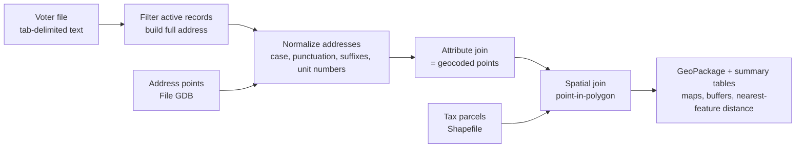

# Geocoding and Spatial Integration of NC Public Records

**Wake and Pitt Counties, North Carolina** · Python · GeoPandas · ~1.1 million records

Course final project, CSCI 6905 *Geospatial Thinking in Python*, East Carolina University (2025).

## What this project does

It builds a reproducible pipeline that turns three unlinked public datasets into one analysis-ready spatial table:

| Source | Format | Publisher |
|---|---|---|
| Statewide voter registration file (county extracts) | Tab-delimited text | NC State Board of Elections |
| County address points | Esri File Geodatabase | County GIS (NC OneMap) |
| County tax parcels with assessed value | Shapefile | County GIS (NC OneMap) |

Text records have no coordinates, so each one is matched to an address point through a normalized address key and then spatially joined to the parcel that contains it. The result links each record to a location and an assessed property value.

## Pipeline results

| Step | Pitt County | Wake County |
|---|---:|---:|
| Raw records loaded | 147,572 | 960,620 |
| Active records after cleaning | 102,083 | 739,250 |
| Matched to an address point (geocoded) | 66,326 (65.0% of active) | 538,023 (72.8% of active) |
| Joined to a tax parcel | 61,772 (93.1% of geocoded) | 537,856 (99.97% of geocoded) |

## Data-quality findings

Most of the work was in finding and handling problems in the source data:

- **Match-rate gap between counties.** Pitt geocoded at 65% against Wake's 73%. Address formatting differs between the voter file and the address points: unit designators (`#G`), street-suffix abbreviations (`DR` vs `DRIVE`), punctuation, and spacing. A shared normalization function (lower-casing, unit stripping, suffix expansion, punctuation and ZIP removal) builds the join key on both sides. The records that still fail to match are the natural target for fuzzy matching in a next iteration.
- **Heavily skewed parcel values.** In Wake, mean assessed value for one group was about $9.6M against a median of about $505K, because many records sit on multi-unit and commercial parcels. Comparisons therefore use medians, log scales, and outlier filtering, not means.
- **Zero-value and malformed fields.** Some parcels have an assessed value of $0, and a numeric acreage field (`RECAREANO`) is stored as decimals but typed as integer, so it gets silently truncated on read. Both are flagged rather than trusted.
- **Coordinate systems.** Layers arrive in different CRSs and are reprojected before every spatial join and distance calculation.

## Spatial analyses

- Point-in-polygon joins of geocoded records to parcels, deduplicated on the record ID (NCID)
- 500 ft buffers around records (NC State Plane, EPSG:2264, US feet) and maps of records near public schools
- Nearest-feature distance from each record to the closest park, exported as an interactive Folium map
- Urban/rural comparison by municipality
- Kernel-density maps showing how registration attributes cluster across each county
- Summary tables of assessed parcel value grouped by registration attributes, exported to CSV and Excel

## Privacy and reproducibility

The voter file is a public record, but it contains names and home addresses. **This repository therefore holds no data and no record-level output.** Notebook outputs are cleared and `.gitignore` blocks data files.

To reproduce:

1. Download the county voter extracts from the [NC State Board of Elections](https://www.ncsbe.gov/results-data/voter-registration-data), plus address points and parcels for Wake and Pitt from [NC OneMap](https://www.nconemap.gov/).
2. Put them in a `data/` folder with the layout the notebook expects, or set the `NC_GEO_DATA` environment variable to their location.
3. Run `pip install -r requirements.txt`, then open `wake_pitt_geospatial_analysis.ipynb`.

## Skills shown

Large-file ingestion · data cleaning and validation · string normalization for record linkage · geocoding · spatial joins · CRS management · buffer and nearest-neighbor analysis · robust summary statistics · static and interactive mapping
